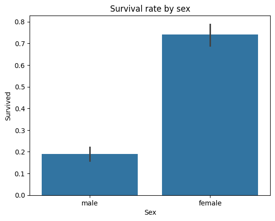
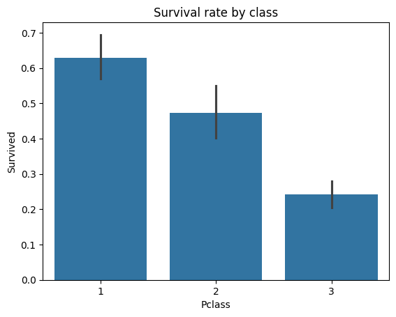
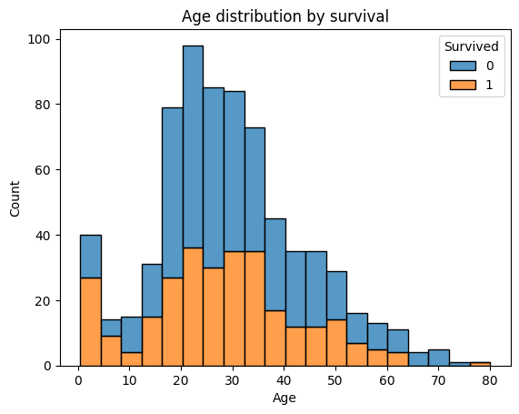

# Titanic — Exploratory Data Analysis

Who survived the Titanic, and why? An end-to-end exploratory data analysis
in Python — from cleaning the raw data to visualising the patterns behind survival.

## The question

Using the passenger records from the Titanic, I set out to understand which
factors were linked to survival, and to practise the full data-analyst
workflow: load, clean, explore, visualise, and explain.

## Dataset

- **Source:** Titanic — Machine Learning from Disaster (Kaggle)
- **Size:** 891 passengers, 12 columns

## What I did

1. **Loaded and inspected** the data — checked its shape, data types and missing values.
2. **Cleaned it** — filled missing ages with the median, dropped the `Cabin`
   column (too many blanks), removed rows with a missing port, and dropped duplicates.
3. **Explored it** — compared survival rates by sex, passenger class and age.
4. **Visualised the findings** with bar charts and a histogram.
5. **Wrote up the key insights** below.

## Key insights

1. **Women survived far more than men** — about 74% vs 19%.
2. **First-class passengers survived more** than third-class passengers.
3. **Younger passengers** had a higher survival rate than older ones.

## Charts

## Tools used

Python  Pandas  NumPy  Matplotlib  Seaborn  Jupyter / Google Colab

## How to run

1. Install the libraries: `pip install -r requirements.txt`
2. Download `train.csv` from the Kaggle dataset into a `data/` folder.
3. Open `notebooks/01_eda_starter.ipynb` and run all cells.

---

Meghana J  [LinkedIn](https://www.linkedin.com/in/meghana-j-16904a21b)
